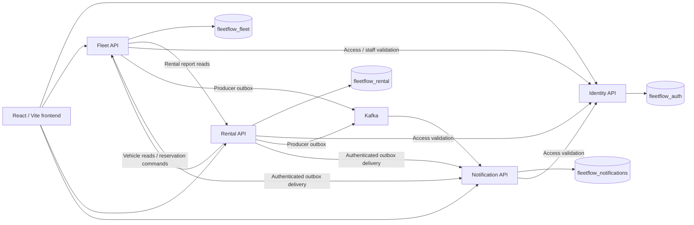

# FleetFlow — Sprint 4 Development and DevOps Handoff

Prepared on **14 October 2026** for the teammate responsible for Azure deployment.

Repository: [IT24103433/Fleet_Flow](https://github.com/IT24103433/Fleet_Flow). Development work is merged into `develop`; production deployment and deployed QA are still pending.

## 1. Start here

The application previously had two backend services. Sprint 4 separates it into **four independently running .NET 10 APIs**, retains the React/Vite website, and completes rental handovers, maintenance planning, reliable notifications, account security and exports.

**Do not deploy using the old two-service infrastructure unchanged.** Inspect the existing Azure resources first, prepare all four APIs and their databases, rehearse the migration, then perform a coordinated release with a write pause. The migration tools currently enforce local/loopback targets; they are not ready-made Azure cutover commands.

Verified repository state at preparation:

| Item | State |
|---|---|
| `develop` | `28aa5af2636044ec76d2d0fa4ebf7e7f27358ee9` — includes merged logout confirmation PR #43 |
| `main` | `48a2d2447b8e717b7f76c6d543b9d91c35480c65` — not yet the Sprint 4 release |
| Development | S4-01–S4-11 complete and merged: **34 of 36 points** |
| S4-12 | **Open:** actual deployment and deployed QA evidence required |
| Latest feature CI | [Run 38569452931](https://github.com/IT24103433/Fleet_Flow/actions/runs/38569452931): all six checks green, **631 backend / 166 frontend tests** |
| Azure changes by this development task | None; no working/deployed fleet data was migrated or replaced |

Recheck branch heads and CI before selecting a release; these values describe this handoff's snapshot.

## 2. What was delivered

The baseline remains **4 epics, 12 stories, 36 points**. Service extraction is additional architecture work, not additional story points.

| Story | Points | Delivered behavior | Merged PR |
|---|---:|---|---|
| S4-01 Start rental / pickup | 3 | Admin/Fleet Manager pickup, actual time, odometer, fuel and condition; durable active vehicle hold | [#37](https://github.com/IT24103433/Fleet_Flow/pull/37) |
| S4-02 Complete rental / return | 5 | Return receipt, odometer validation, lateness flag, original estimate and final LKR amount; manual extra charge requires a reason | [#39](https://github.com/IT24103433/Fleet_Flow/pull/39) |
| S4-03 Lifecycle timeline | 2 | Saved rental/booking history for staff and the owning customer; historical unknown times remain unknown | [#39](https://github.com/IT24103433/Fleet_Flow/pull/39) |
| S4-04 Planned maintenance | 4 | Explicit planned windows, booking-aware conflict checks and valid adjacent/non-overlapping periods | [#40](https://github.com/IT24103433/Fleet_Flow/pull/40) |
| S4-05 Maintenance assignment | 2 | Assign/reassign to active Maintenance Staff validated through Identity | [#40](https://github.com/IT24103433/Fleet_Flow/pull/40) |
| S4-06 Maintenance audit | 2 | Append-only real activity history, preserving creator and assignment information | [#40](https://github.com/IT24103433/Fleet_Flow/pull/40) |
| S4-07 Notification reliability | 5 | Transactional producer outboxes, retry, deduplication, failed-delivery visibility and guarded replay | [#35](https://github.com/IT24103433/Fleet_Flow/pull/35) |
| S4-08 Access revocation | 3 | Password, role and status changes invalidate old sessions across all protected services | [#41](https://github.com/IT24103433/Fleet_Flow/pull/41) |
| S4-09 API hardening | 2 | Validation, ownership/permission safeguards, current-password checks and final-active-admin protection | [#41](https://github.com/IT24103433/Fleet_Flow/pull/41) |
| S4-10 Report exports | 2 | Authorized booking/maintenance CSV downloads, existing filters, spreadsheet-safe escaping | [#38](https://github.com/IT24103433/Fleet_Flow/pull/38) |
| S4-11 Integration/regression/performance | 4 | Four-service rehearsal, regression evidence, bounded timings and release handoff | [#42](https://github.com/IT24103433/Fleet_Flow/pull/42) |
| S4-12 Deployment verification | 2 | Must be completed after the actual coordinated deployment and deployed QA | Pending |

Architecture/release work: [#32](https://github.com/IT24103433/Fleet_Flow/pull/32) release gate; [#33](https://github.com/IT24103433/Fleet_Flow/pull/33) approved frontend baseline; [#34](https://github.com/IT24103433/Fleet_Flow/pull/34) four-service foundation; [#35](https://github.com/IT24103433/Fleet_Flow/pull/35) Notification extraction; [#36](https://github.com/IT24103433/Fleet_Flow/pull/36) Rental extraction. S4-07 is counted once.

The frontend retains its approved graphite/ivory/violet theme, typography, Phosphor icons, licensed component/image credits and restrained GSAP motion. Rental queue, pickup/return, timeline, maintenance, reporting and security screens integrate with existing contracts. Hash routes retain record IDs, ownership, forced-password behavior and duplicate-submission guards. [#43](https://github.com/IT24103433/Fleet_Flow/pull/43) adds Cancel/Log out confirmation; automatic security sign-out remains immediate. Desktop evidence is at 1440 × 900; dedicated mobile/tablet acceptance was outside the agreed scope.

## 3. How the services were divided

| API | Owned database | Local port | Owns | Startup DLL |
|---|---|---:|---|---|
| IdentityService.Api | `fleetflow_auth` | 5001 | Accounts, credentials, roles, profiles, browser JWTs, access versions, internal token broker | `IdentityService.Api.dll` |
| FleetService.Api | `fleetflow_fleet` | 5002 | Vehicles, photographs, maintenance, assignment/audit, reservation ledger and report composition | `FleetService.Api.dll` |
| RentalService.Api | `fleetflow_rental` | 5003 | Bookings/cancellation, durable workflows/recovery, pickup/return, final amounts and timeline | `RentalService.Api.dll` |
| NotificationService.Api | `fleetflow_notifications` | 5004 | Inbox, unread/read state, event receipts, Kafka consumption and deduplication | `NotificationService.Api.dll` |

One PostgreSQL server can host all four databases. Each service uses its own database and production database role; runtime services do not query another service's tables. Cross-service IDs are references rather than cross-database foreign keys. Shared contracts/defaults are libraries, not a fifth service.



Maintenance stays in Fleet because maintenance windows, booking reservations and availability changes must use the same vehicle lock. Rental saves durable workflow intents before calling Fleet's idempotent commands; booking success requires both the booking and availability reservation to be durable. Interrupted operations reconcile after restart; uncertain holds stay blocked. There is no cross-database atomic transaction claim.

Fleet retains compatibility forwarding for existing booking/notification paths after explicit cutover. Failures return unavailable rather than reading stale legacy tables. Exactly one active writer owns each extracted domain. Reports compose authorized Rental API responses.

Business changes and producer outbox rows commit together. Retries retain event identity; Notification deduplicates HTTP/Kafka delivery and preserves read acknowledgements. This is an application inbox, not a new email/SMS provider.

Browser JWTs and internal service tokens have separate keys/audiences. Internal tokens are short-lived and have fixed scopes; browser tokens cannot invoke reservation commands. Fleet/Rental/Notification validate current account access with Identity and fail closed when validation is unavailable. Production availability therefore depends on Identity as well as the owned databases.

## 4. Repository map and build artifacts

Paths below are relative to the repository root:

| Path | Purpose |
|---|---|
| `FleetFlow.sln` | Full solution: four APIs, shared libraries, tools and backend tests |
| `src/backend/services/<Service>/<Service>.Api/` | One independently publishable API project |
| `src/backend/shared/` | Contracts and service defaults |
| `src/backend/Dockerfile.service` | Builds one selected service using .NET 10 SDK/runtime images |
| `src/frontend/` | React 19 / Vite 8 frontend; locked npm dependencies |
| `docker-compose.yml`, `docker-compose.services.yml` | Local infrastructure and opt-in Development API overlay; not Azure provisioning |
| `tools/ServiceDatabaseTool/` | Guarded owned-database initialization |
| `tools/NotificationMigration/`, `tools/RentalMigration/` | Verified imports, schema upgrades and constrained recovery |
| `tools/Start-Services.ps1` | Local-only service startup helper |
| `tools/Sprint4Review/Run.ps1` | Private four-service Linux rehearsal, synthetic data, verification and cleanup |
| `docs/`, `docs/review/` | Contracts, migration/recovery documentation, screenshots and sanitized evidence |

CI uses Linux, .NET 10 and Node 22.x. Use a Vite-compatible Node 22 version (22.12+), `npm ci` and the committed lockfile. CI uploads `backend-binaries`, containing separate `identity-service`, `fleet-service`, `rental-service`, `notification-service`, `database-tool`, `notification-migration` and `rental-migration` directories. Other artifacts include `frontend-dist`, `backend-test-results` and `frontend-bundle-budget`. Retention is currently seven days; rebuild/retrieve the selected release artifacts if expired.

Build from the repository root:

```powershell
dotnet restore FleetFlow.sln
dotnet build FleetFlow.sln --no-restore --configuration Release
```

For a native .NET deployment, publish each API project separately and start its corresponding DLL from its own publish directory. Verify .NET 10 availability on the chosen Azure runtime rather than using the old .NET 8 setting.

For containers, run the following pattern once per service, replacing the argument/tag with each of the four names:

```powershell
docker build -f src/backend/Dockerfile.service --build-arg SERVICE=IdentityService -t fleetflow-identity:<release-tag> .
```

The container listens on **8080**; ports 5001–5004 are local conventions, not mandatory Azure ingress ports. Configure the host's container port and health routing accordingly. The combined `Sprint4Review` image is a rehearsal convenience, not the production artifact.

## 5. Azure preparation and existing gaps

The Azure owner should first inventory the subscription, resource group, region, budget/credits, existing apps/plan, PostgreSQL server, uploads, Kafka and repository deployment permissions. Record their actual names and URLs; do not assume the template's names match deployed resources.

Provide four independently deployed API apps, one frontend host, four owned databases, persistent upload storage, reachable Kafka and monitoring. Resource sizing must follow the actual subscription and measured load; the local rehearsal does not prove the old B1 plan is sufficient. If using App Service for background workers, configure an appropriate plan and Always On so outbox/recovery/consumer processes continue running.

**Repository gaps the DevOps owner must resolve before rollout:**

- `infra/main.bicep` is a legacy two-API/two-database template with `.NET 8` settings. It does not provision the complete four-service topology or Kafka.
- `infra/deploy.ps1` provisions the legacy topology and prints publishing profiles. Do not run it unchanged or share its credential output.
- The legacy develop, Identity, Fleet and frontend deployment workflows are **manual-only**. Ordinary CI stays automatic. A merge into `main` does not deploy the completed release. Add/adapt a coordinated deployment workflow for all four APIs and the correctly configured frontend.
- Prefer GitHub/Azure OIDC for deployment identity, with approved repository environments and scoped Azure permissions. See [Microsoft's GitHub Actions deployment guidance](https://learn.microsoft.com/en-us/azure/app-service/deploy-github-actions?tabs=openid).
- Verify trusted reverse-proxy/HTTPS forwarding. The non-Development token broker checks `Request.IsHttps`; public HTTPS alone is insufficient if the application sees an untrusted HTTP scheme behind TLS termination. Confirm this before activating internal service calls; do not weaken the HTTPS requirement.
- Kafka clients currently expose broker/topic/group settings but not SASL/security-protocol settings. Do not assume Azure Event Hubs or a managed SASL/TLS endpoint is a drop-in replacement. Choose compatible private infrastructure, or separately implement and test the provider's required client configuration. Do not expose a plaintext broker publicly.

For custom App Service containers, persist uploads through a configured persistent mount rather than the container's writable layer. Set upload roots to that mount, ensure the non-root container user can write there, and verify photographs survive replacement/restart. See [Microsoft's container storage guidance](https://learn.microsoft.com/en-us/azure/app-service/configure-custom-container?pivots=container-linux&tabs=debian).

## 6. Configuration checklist

Store private values in approved Azure/GitHub secret storage. This README intentionally contains setting names, not passwords, JWT keys, publishing profiles, private exports or default QA credentials. Use `ASPNETCORE_ENVIRONMENT=Production`; local `.env.example`/Compose defaults are deliberately **Legacy/inactive**, not a completed production cutover configuration.

### All APIs

| Setting | Requirement |
|---|---|
| `ConnectionStrings__DefaultConnection` | Explicit Npgsql connection to that API's owned database, least-privilege credentials and production TLS; alternatively configure `DB_HOST`, `DB_PORT`, `DB_USER`, `DB_PASSWORD` and the owned database-name key |
| `AUTH_DB_NAME`, `FLEET_DB_NAME`, `RENTAL_DB_NAME`, `NOTIFICATION_DB_NAME` | Corresponding service's exact owned database name |
| `Jwt__Key` | Shared private browser-JWT validation key across the four APIs |
| `Jwt__Issuer` / `Jwt__Audience` | Preserve `FleetFlow.IdentityService` / `FleetFlow.Client` |
| `SERVICE_AUTH_ENABLED=true` | Enable configured internal authentication for the extracted topology |
| `SERVICE_AUTH_SIGNING_KEY` | Separate strong internal key, different from the browser JWT key |
| `ALLOWED_ORIGINS` | Comma-separated exact frontend HTTPS origin(s); not a wildcard |

The local startup helper maps `JWT_SECRET`, `JWT_ISSUER`, `JWT_AUDIENCE` and Kafka aliases. Azure app settings should use the direct .NET names shown here; do not assume the local helper runs in Azure.

### Per-service private configuration

| Recipient | Settings / behavior |
|---|---|
| Identity | `SERVICE_AUTH_FLEET_SECRET`, `SERVICE_AUTH_RENTAL_SECRET`, `SERVICE_AUTH_NOTIFICATION_SECRET`; `IDENTITY_UPLOAD_ROOT` on persistent storage |
| Fleet | Its own `SERVICE_AUTH_FLEET_SECRET`; `INTERNAL_IDENTITY_URL`, `INTERNAL_RENTAL_URL`, `INTERNAL_NOTIFICATION_URL`; `FLEET_UPLOAD_ROOT` on persistent storage |
| Rental | Its own `SERVICE_AUTH_RENTAL_SECRET`; `INTERNAL_IDENTITY_URL`, `INTERNAL_FLEET_URL`, `INTERNAL_NOTIFICATION_URL` |
| Notification | Its own `SERVICE_AUTH_NOTIFICATION_SECRET`; `INTERNAL_IDENTITY_URL` |

Each client secret must match its Identity entry and contain at least 32 UTF-8 bytes; generate strong random secrets. Internal URL values are fixed trusted HTTPS API roots, without query strings, credentials or record paths. The backend must reach these roots independently of browser CORS.

After verified migration, set Fleet `RENTAL_OWNERSHIP=Remote` with the matching `RENTAL_MIGRATION_ID`; set Rental `RENTAL_SERVICE_ACTIVE=true` with the same verified migration ID and schema **4**. Set Fleet `NOTIFICATION_OWNERSHIP=Remote`; set Notification `NOTIFICATION_SERVICE_ACTIVE=true` and its verified `NOTIFICATION_MIGRATION_ID`. Never invent receipt IDs to activate readiness.

Configure Fleet, Rental and Notification with `Kafka__Enabled=true`, a reachable `Kafka__BootstrapServers`, and matching domain topics/groups. Preserve `Kafka__BookingEventsTopic=fleetflow.booking.events`, `Kafka__MaintenanceEventsTopic=fleetflow.maintenance.events`, `Kafka__VehicleEventsTopic=fleetflow.vehicle.events` and Notification's `Kafka__NotificationConsumerGroupId=fleetflow.notifications.group`, unless an explicitly coordinated environment mapping is used. Provision required topics and retain offsets; the Notification consumer does not auto-create topics.

Keep production QA seeding off unless explicitly approved. It is opt-in through `QA_SEED_ENABLED`/`QA_SEED_PASSWORD`; startup does not reset existing accounts' passwords, roles, status or access versions.

### Frontend build-time settings

```text
VITE_IDENTITY_API_URL=https://<identity-host>
VITE_FLEET_API_URL=https://<fleet-host>
VITE_RENTAL_API_URL=https://<rental-host>
VITE_NOTIFICATION_API_URL=https://<notification-host>
```

Set all four to actual public API roots **before** `npm run build`. No secrets belong in `VITE_*`; they become public browser code. Changing host settings after building does not update a Vite bundle. Verify the release bundle has the intended roots rather than localhost or old service URLs. Preserve packaged image/font/license assets; runtime files must not depend on a developer's Z drive.

If using a static host, deploy the complete `dist` directory and serve its assets with appropriate MIME types. If using the existing Node App Service approach, prepare `dist/server.js` from `src/frontend/server.js` and `dist/package.json` from `src/frontend/package.deploy.json`, as the legacy frontend workflow does, and configure `node server.js`. The plain CI `frontend-dist` artifact and that Node deployment package are different; include the server files when choosing that host.

## 7. Migration and coordinated release order

This is a release checklist, not authorization to execute data changes. The DevOps owner must confirm actual targets, rehearse the chosen Azure procedure and arrange a maintenance/write-pause window. For a fresh environment, schema initialization and activation receipts are still required; empty databases do not justify fabricated receipts.

1. Select the reviewed release SHA from updated `develop`, prepare/review a `develop` → `main` release PR and ensure required CI passes. Preserve the approved frontend backups separately. Deploy artifacts from one identified release, not a mix of story milestones.
2. Inventory existing database/vehicle/booking/maintenance/image relationships and upload locations. Pause booking, maintenance, vehicle, handover and inbox writes; stop recovery workers, producers and consumers for the migration snapshot. Keep writes paused through owner activation and verification.
3. Back up current auth/Fleet and any existing Rental/Notification databases, Identity/Fleet uploads, migration manifests and Kafka offsets. SHA-256-check backups and **restore into isolated verification databases** to compare row counts, content fingerprints and relationships. Never verify by restoring over working databases. Store dumps/exports/receipts privately outside Git.
4. Provision secured destination databases/apps/storage. Perform the verified Notification inbox import first, preserving original IDs, timestamps, recipients and read states. Verify counts/checksums and the import receipt.
5. Perform verified Rental booking import plus Fleet reservation-ledger import. Preserve booking IDs, users/vehicles, statuses, estimates, timestamps and history. Verify both legs and the matching receipt; retain legacy source tables unchanged. Fresh Rental imports install schemas 1–4; an already extracted older Rental installation needs the documented `upgrade-rentals` path to schema 4 with fresh verified backups.
6. Deploy compatible Identity/Fleet/Rental/Notification artifacts. Identity applies additive `Users.AccessVersion` initialization before readiness. Fleet applies additive planned-window/assignment fields and append-only maintenance audit schema before readiness. Confirm database permissions support these reviewed installation steps. Preserve existing account and historical data.
7. Under the pause, activate the verified Notification and Rental owners using their receipt settings; configure internal authentication/URLs, Kafka, uploads and exact frontend origins. Keep one writer per domain. Deploy the frontend built with all four public roots.
8. Verify all four readiness checks, service-token issuance/scopes, ownership routing, ledger/inbox integrity, Kafka delivery, CORS and persistent images. Existing unversioned JWTs must sign in again. Resolve pending workflows before reopening writes.
9. Reopen only after these checks succeed; run deployed QA and record the evidence in section 10. S4-12 remains open until that actual acceptance is complete.

The published `ServiceDatabaseTool`, `NotificationMigration` and `RentalMigration` enforce target/receipt/hash/write-pause guards. **They are loopback rehearsal tools, not Azure scripts.** Plan a reviewed production-equivalent procedure and connectivity explicitly; do not remove guard checks or change names/receipts merely to force a run. Detailed command modes and backup receipt formats are in the documents linked below.

## 8. Recovery and rollback constraints

Take a new verified safety backup and pause writes before recovery. Once the new services have accepted writes, switching flags/URLs back to preserved legacy tables would lose or misrepresent newer history.

- Resolve durable pending booking/pickup/return workflows with compatible Fleet/Rental code. Do not manually clear uncertain holds to make a vehicle appear available.
- The legacy Rental reconciliation path refuses pickup history. After a pickup/return intent exists, retain schema-4-compatible services and resolve forward unless a separate lifecycle-aware recovery migration is reviewed.
- Preserve notification event identities, inbox/read states, outboxes and Kafka offsets. Replay through the authorized operation; do not delete history to conceal failed delivery.
- Preserve maintenance windows/audit and account access versions/current credentials. Earlier Fleet or Identity binaries do not necessarily enforce these invariants; independent downgrades are unsafe.
- A frontend backup restore affects presentation only. It does not undo database history, vehicle availability, final charges or notifications.

## 9. Existing evidence and what it proves

The latest feature CI passed **631 backend and 166 frontend tests**, with zero failures/skips, plus lint, Release packaging, frontend production build and the quality gate. The prior S4-11 release rehearsal passed **10 live workflow groups and 190 timed requests with zero errors**. It used private Linux containers, a fresh small synthetic dataset and separate restore verification; it did not write to Azure or alter working fleet data.

| Warm local workload | Requests | p95 |
|---|---:|---:|
| Public Fleet reads | 100 | 8.92 ms |
| Protected Rental booking reads | 50 | 23.16 ms |
| Composed Fleet reports | 30 | 14.51 ms |
| Durable booking writes | 10 | 43.19 ms |

These short Development bursts are not production SLOs, sustained throughput or Azure sizing evidence. Kafka was disabled in the HTTP rehearsal; real Kafka outage/duplicate/restart coverage runs in CI. Recheck deployed behavior with the actual broker.

The latest frontend entry plus recursive static JavaScript imports is **312,637 uncompressed bytes**, below the **350,000-byte** gate. Lazy homepage chunks are measured separately. Source budgets and local desktop screenshots do not replace deployed QA.

## 10. Deployed QA and S4-12 sign-off

Check each API's `/health/live`, `/health/ready` and `/openapi/v1.json`. Liveness alone is not proof of activated business ownership or available dependencies; confirm readiness and actual protected workflows too.

- **Customer:** real catalogue/photos, filters, availability/estimate, single booking submission, record refresh/Back, own booking/timeline, eligible cancellation and truthful failure states.
- **Rental:** Admin/Fleet Manager pickup within booked bounds; other roles denied; active rental cannot cancel; return mileage cannot decrease; positive manual charge needs a reason; original/final LKR amounts and late flag are accurate; repeat return is rejected; availability/maintenance state is correct.
- **Maintenance/reports:** overlaps conflict, valid adjacent windows succeed, unknown-end records remain conservative, assignments require active Maintenance Staff, audit is retained, reports/CSV filters and permissions work.
- **Notifications:** durable events arrive once, read state survives restart, retry/replay is authorized, duplicate HTTP/Kafka events do not duplicate inbox entries.
- **Security/navigation:** password/role/status changes revoke old sessions across all services; forced-password flow works; Identity failure does not grant access; account photos remain isolated; Cancel/Log out behaves correctly.
- **Operations:** all four processes run independently, uploads survive restart/redeployment, configured URLs/CORS/HTTPS work, logs show no secrets, pending recovery/outbox activity is monitored. Run disruptive fault/recovery checks in an approved non-production environment.

Record and retain:

| Release evidence | To be completed by DevOps / QA |
|---|---|
| Selected release SHA, CI run, artifact/image digests | Pending |
| Subscription/resource group/environment; four API URLs and frontend URL | Pending |
| Backup hashes, isolated restore results and import/schema receipts | Pending |
| Deployed service settings confirmed, without secret values | Pending |
| Deployment timestamp and DevOps owner | Pending |
| QA owner, check results, desktop screenshots and known limitations | Pending |
| Recovery decision / verified rollback or forward-repair procedure | Pending |
| S4-12 acceptance | Open until deployed evidence passes |

## 11. Detailed references

These documents describe individual milestones; older test counts and “next work” statements belong to those milestones. For current release status, use this README and the merged S4-11 handoff.

- [S4-11 release handoff and evidence](https://github.com/IT24103433/Fleet_Flow/blob/develop/docs/s4-11-release-handoff.md)
- [Four-service foundation and internal authentication](https://github.com/IT24103433/Fleet_Flow/blob/develop/docs/four-service-foundation.md)
- [Notification import, outbox and recovery](https://github.com/IT24103433/Fleet_Flow/blob/develop/docs/notification-extraction-outbox.md)
- [Rental extraction, ledger, import and reconciliation](https://github.com/IT24103433/Fleet_Flow/blob/develop/docs/rental-extraction-recovery.md)
- [Pickup rules and recovery limits](https://github.com/IT24103433/Fleet_Flow/blob/develop/docs/s4-01-rental-pickup.md)
- [Return, timeline and schema-4 upgrade](https://github.com/IT24103433/Fleet_Flow/blob/develop/docs/s4-02-03-rental-completion.md)
- [Maintenance schema, assignment and audit](https://github.com/IT24103433/Fleet_Flow/blob/develop/docs/s4-04-06-maintenance-planning.md)
- [Account access versions, API safeguards and recovery](https://github.com/IT24103433/Fleet_Flow/blob/develop/docs/s4-08-09-access-hardening.md)
- [CSV exports](https://github.com/IT24103433/Fleet_Flow/blob/develop/docs/s4-10-report-exports.md)
- [Sanitized rehearsal/performance results](https://github.com/IT24103433/Fleet_Flow/blob/develop/docs/review/s4-11-integration-performance.json)
- [Latest logout review](https://github.com/IT24103433/Fleet_Flow/blob/develop/docs/review/logout-confirmation.md)

The DevOps teammate owns Azure provisioning, deployment identity, production configuration/migration and release execution. QA owns deployed acceptance. Development has supplied the implementation and local/CI evidence; deployment must not be described as complete until those remaining steps succeed.
