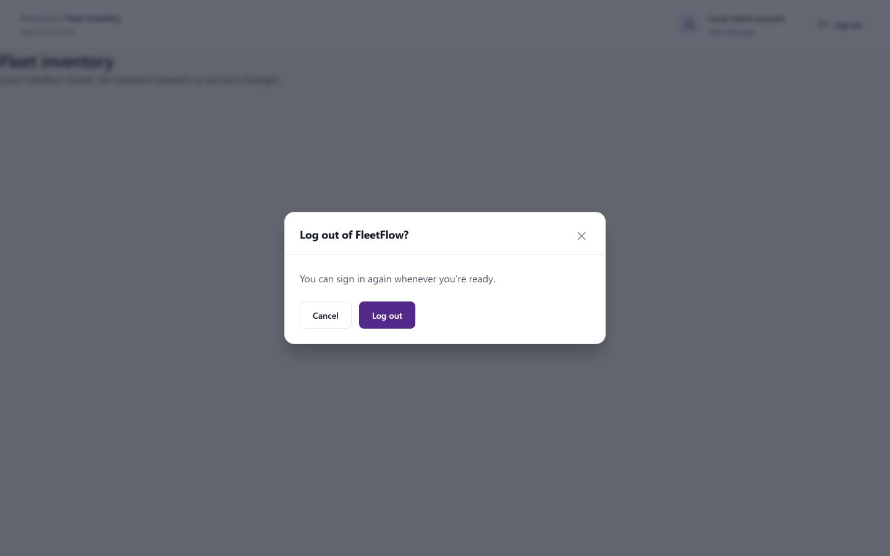

# Logout confirmation review

Manual logout now opens the existing accessible confirmation dialog for customer, staff, administrator and forced-password navigation. Cancel, Escape, backdrop and close dismiss the prompt without clearing the session. Confirm retains the previous logout/navigation behavior and prevents duplicate submissions. Expired/revoked sessions continue signing out immediately; a changed session invalidates an earlier prompt.

Desktop review at 1440 × 900 used the actual StaffHeader, AuthProvider and application styles with an isolated UI fixture. Cancel returned focus to the trigger; confirmation showed the signed-out state. No backend requests or account changes were made. The temporary fixture and server were removed after review.

Validation: 166 frontend tests passed (all previous 162 plus four focused session/confirmation tests); lint, production build and diff check passed. Uncompressed entry JavaScript plus static imports: 312,637 bytes, below the 350,000-byte limit. No backend, database, deployment or dependency changes.
