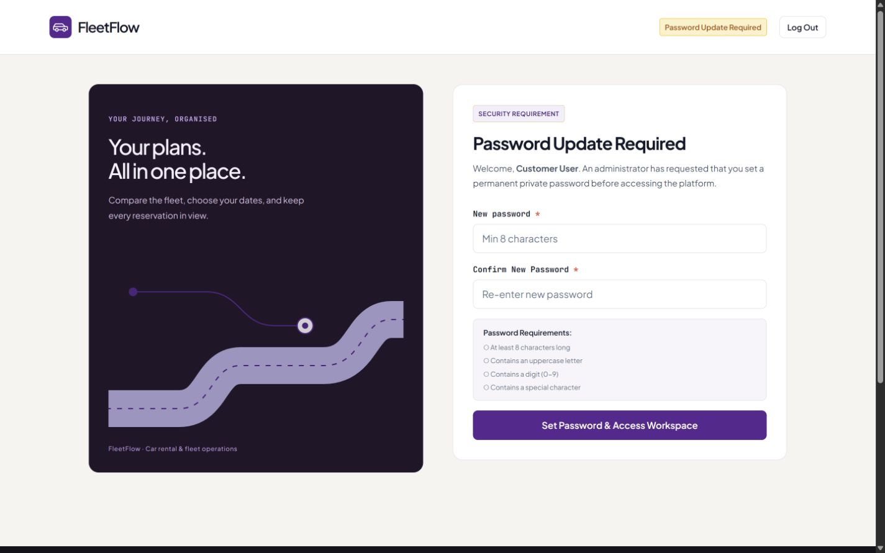
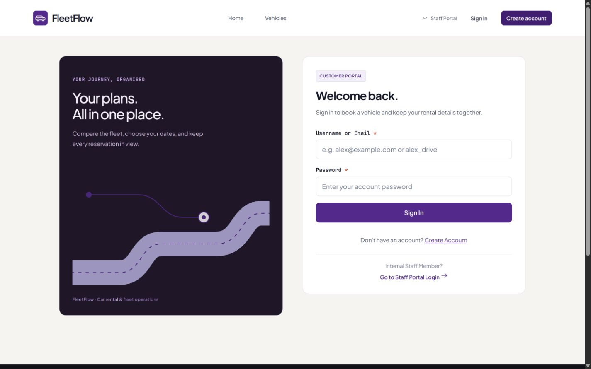

# S4-08 / S4-09: Account access revocation and API hardening

Password changes/resets, role changes, activation changes and changes to the forced-password flag advance a persisted Identity account access version. Previously issued sessions are rejected on their next protected request across Identity, Fleet, Rental and Notification. Profile-only edits and unchanged status/role values do not unnecessarily revoke access. Deleting an account makes its sessions invalid. This group delivers S4-08 (3 points) and S4-09 (2 points).

## Request and account consistency

Identity issues signed browser JWTs containing `access_version`. It validates protected requests against its own database. The other services request current state through `GET /internal/accounts/{userId}/access`, using the separate internal audience and restricted `identity.access.read` permission. They never query Identity tables. Account state is not cached; the existing short-lived internal service-token cache is retained.

Missing, inactive or mismatched account versions return 401 with `session_revoked`. Missing/malformed version claims are also rejected, so sessions issued before this release must sign in again. A missing Identity account returns a typed `account_not_found` response; a missing/misconfigured endpoint, failed internal authentication, malformed response, timeout or unavailable Identity returns 503 with `access_verification_unavailable`. Neither response enters the protected operation. Public browsing remains available. Internal endpoints retain their existing audience/scope checks; browser JWTs cannot invoke account-state or reservation commands.

Critical account updates save the password/role/status and version together. The version is an EF concurrency token: a competing stale write receives 409 and must refresh. Administrator demotion, deletion and activation changes also hold an Identity-owned PostgreSQL transaction/advisory lock so competing requests cannot remove the final active administrator. Disabled administrator accounts do not count as an active alternative.

Checks occur when a request enters the protected pipeline. Already accepted durable booking, pickup and return workflows may finish or recover after a later account change. Revocation does not undo accepted operations or cancel reservations.

Ordinary password changes require the current password. A forced-password session can set its permanent password without resubmitting the temporary credential, then receives a fresh versioned session. The client installs that session before opening the workspace, with duplicate-submit protection. A 401 clears only the session that sent the rejected request; a late response cannot sign out a newer session. A 503 preserves the session for retry. Logout/expiry on the forced-password route returns to sign-in.

## API hardening

- Browser JWT validation requires a signed, unexpired HS256 token with the existing issuer/audience; internal tokens remain independently scoped.
- JSON booking/rental, maintenance and admin commands, plus sign-in/registration/password-change actions, have a 65,536-byte request ceiling. Existing upload limits are retained separately.
- Login credentials and newly created/reset/changed passwords have bounded lengths. Existing DTO/domain validation, response fields, role restrictions, report filters and conflict status codes remain intact.
- Unexpected errors return a static JSON problem response and trace ID; exception text, passwords and connection details are not returned. Domain-specific validation/conflict responses take precedence. The frontend understands both JSON and JSON problem responses.
- Identity's public health response returns readiness without exception details. Startup QA seeding creates missing accounts only; it never rewrites existing hashes, roles, status, forced-password state or versions. Production seeding is disabled by default; explicit `QA_SEED_ENABLED=true` requires a configured `QA_SEED_PASSWORD`.

The implementation uses [EF optimistic concurrency](https://learn.microsoft.com/en-us/ef/core/saving/concurrency) and [ASP.NET JWT bearer validation](https://learn.microsoft.com/en-us/aspnet/core/security/authentication/configure-jwt-bearer-authentication?view=aspnetcore-10.0). The cross-service access-version protocol is FleetFlow's application design.

## Upgrade and rollback

DevOps owns deployment. Before rollout, preserve and verify the four databases and uploads using the existing migration/backup procedures. Keep one writer per domain and pause protected writes during coordinated service replacement. Deploy the updated Identity, Fleet, Rental, Notification and frontend together; retain all existing service URLs, secrets, internal audience/scope settings and migration receipts. Identity must be available to the other three services. No new shared database credentials are introduced.

Identity startup applies this additive, idempotent statement to its configured owned database before seeding or readiness:

```sql
ALTER TABLE "Users" ADD COLUMN IF NOT EXISTS "AccessVersion" bigint NOT NULL DEFAULT 0;
```

Existing accounts retain their IDs, passwords, roles, photographs, statuses and relationships. Existing version values are never reset. Verify readiness, sign in again, then check protected requests against all four services. Default QA passwords are not restored on restart; use the account's current password.

For recovery, take a fresh safety backup before any action. Keep `AccessVersion` and all current account data; do not drop/reset the column or restore pre-change credentials merely to roll back code. Prefer a forward fix retaining the revocation guards. An older Identity does not advance versions, and older services do not enforce them; therefore switching individual services to the previous release is not a safe security rollback. Any coordinated older-release recovery requires an owner-reviewed write pause, session invalidation and reconciliation of account changes. Existing booking/rental/notification migration rollback restrictions still apply. No rollback script in this PR writes to working databases, removes history or targets Azure.

## Verification

The existing 155 frontend tests remain; seven focused cases cover current/stale-session 401s, retryable outages, late responses, JSON problem parsing, forced-password renewal/duplicate submission, session clearing and signed-out route recovery. **162 tests pass**, with lint, production build and diff checks passing. Entry plus static imports is **309,255 uncompressed bytes**, below 350,000. Additional lazy homepage static closure is **141,890 bytes**; rental record is **95,522 bytes** and maintenance is **52,168 bytes**, reported separately.

Local security middleware, Identity changes and PostgreSQL concurrency checks passed. Windows Application Control subsequently blocked Fleet assembly loading (`0x800711C7`), preventing completion of the local full-suite gate. It was not weakened or bypassed. Linux CI is the full backend gate. Its added four-service HTTP regression uses a disposable PostgreSQL Identity database, real signed browser/internal tokens, the real protected HTTP pipelines and restricted account-state calls. It covers password change/reset, forced renewal, role/status changes, reactivation, deletion, Identity outage and public browsing; no live account or deployed database is used. Existing contract tests use synthetic active accounts only to isolate their previous role/ownership assertions.

Desktop review at **1440 × 900** used a verified disposable Identity backup copy. The forced-password page retained the approved typography/graphics, stationary inputs, loaded fonts and no horizontal overflow. Header logout and sign-in recovery were checked. Browser credential changes were not submitted; password transition coverage is programmatic. Review processes and the clone were removed afterward. No mobile/tablet review or unrelated redesign was performed.





S4-11 will consolidate integration/performance evidence and the DevOps/QA handoff after this group merges. S4-12 remains open until actual deployment and deployed QA verification succeed.
