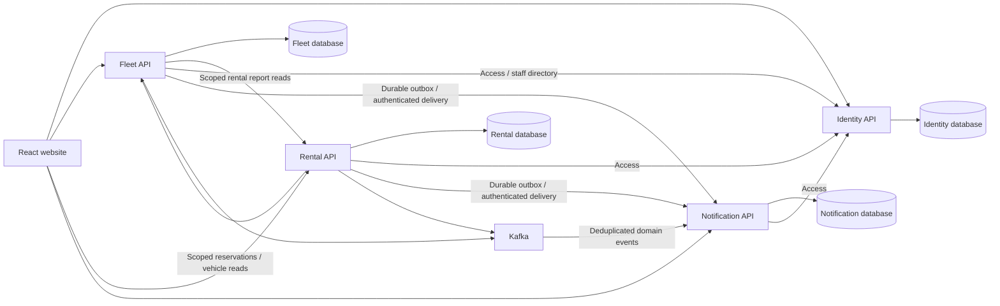

# S4-11: Integration, performance and release handoff

FleetFlow's development release contains four independent services and the completed S4-01–S4-10 features. This PR provides the S4-11 rehearsal, bounded performance evidence, CI bundle gate and DevOps/QA instructions. **S4-12 is open: no Azure deployment or deployed acceptance is claimed.** The approved desktop website and operational controls are unchanged.

## Scope and story accounting

| Story | Points | Development PR | State |
|---|---:|---|---|
| S4-01 Pickup | 3 | [#37](https://github.com/IT24103433/Fleet_Flow/pull/37) | Merged |
| S4-02 Return | 5 | [#39](https://github.com/IT24103433/Fleet_Flow/pull/39) | Merged |
| S4-03 Timeline | 2 | [#39](https://github.com/IT24103433/Fleet_Flow/pull/39) | Merged |
| S4-04 Planned maintenance | 4 | [#40](https://github.com/IT24103433/Fleet_Flow/pull/40) | Merged |
| S4-05 Staff assignment | 2 | [#40](https://github.com/IT24103433/Fleet_Flow/pull/40) | Merged |
| S4-06 Activity audit | 2 | [#40](https://github.com/IT24103433/Fleet_Flow/pull/40) | Merged |
| S4-07 Notification outbox/retry | 5 | [#35](https://github.com/IT24103433/Fleet_Flow/pull/35) | Merged, counted once |
| S4-08 Access revocation | 3 | [#41](https://github.com/IT24103433/Fleet_Flow/pull/41) | Merged |
| S4-09 API hardening | 2 | [#41](https://github.com/IT24103433/Fleet_Flow/pull/41) | Merged |
| S4-10 CSV exports | 2 | [#38](https://github.com/IT24103433/Fleet_Flow/pull/38) | Merged |
| S4-11 Integration/regression/performance | 4 | This PR | Development acceptance evidence |
| S4-12 Deployment verification | 2 | After real deployment | Open |

The baseline remains **12 stories / 36 points**. S4-01–S4-10 account for 30 points; S4-11 adds four after acceptance. Four-service extraction was additional architecture work in PRs #34–#36, not extra story points or a second S4-07 completion. The release gate and approved frontend baseline were PRs #32/#33.

## Current service boundaries

| Service | Owned database | Local port | Business responsibility |
|---|---|---:|---|
| IdentityService.Api | fleetflow_auth | 5001 | Accounts, roles, profiles, browser tokens, access versions and internal token broker |
| FleetService.Api | fleetflow_fleet | 5002 | Vehicles/photos, maintenance/windows/assignment/audit, reservation ledger and composed reports |
| RentalService.Api | fleetflow_rental | 5003 | Bookings/cancellation, durable recovery, pickup/return, final amounts and lifecycle history |
| NotificationService.Api | fleetflow_notifications | 5004 | Inbox/read states, Kafka consumption, delivery receipts/deduplication and rejected-event visibility |



Each service owns its tables; cross-service IDs are references, not cross-database foreign keys. Maintenance and reservations share Fleet's vehicle-row lock. Rental commits recoverable intents before remote commands and reports success only after both booking and availability hold are durable. Unknown reservations remain conservatively blocked. Producer outboxes commit with business changes; retries preserve event IDs and Notification deduplicates HTTP/Kafka delivery. Reports compose authorized Rental responses without querying Rental tables.

## Reproduce the isolated rehearsal

The runner uses a **new private PostgreSQL container/volume**, four separate Linux API containers and loopback HTTP ports **15101–15104**. It never reads working `.env` credentials, reuses working containers, publishes PostgreSQL, targets Azure, or alters the booked Lamborghini. It uses Development settings, synthetic QA accounts and one clearly labelled demonstration vehicle; missing images remain missing. This fresh-dataset rehearsal complements the earlier verified historical migration rehearsals and PostgreSQL/Kafka regression tests.

Requirements: Docker Desktop running Linux containers, .NET image download access, Node 22+ and PowerShell. From the repository root:

```powershell
./tools/Sprint4Review/Run.ps1
```

The first run builds `tools/Sprint4Review/Dockerfile` from official .NET SDK/runtime images. Subsequent runs can use `-SkipBuild` only when that image still matches the source being reviewed. Four services remain separate processes/containers; the combined review image is a cache convenience and is not the production deployment artifact.

The runner creates a unique `fleetflow-s411-<id>` project. Before activation it stops writers, dumps auth/Fleet, restores each into a separate verification database and compares every public table's row count/content fingerprint. It verifies an empty fresh upload archive, then runs the existing hash-checked Notification/Rental imports and schema-4 upgrade with a verified Rental safety dump. It records the returned receipts and activates exactly one writer per domain. No migration guard or backup receipt is fabricated to bypass verification.

`ReviewResults/<id>/` is excluded from Git and Docker build context. It holds private dumps, exports, backup receipts and sanitized `result.json`/`cleanup.json`. Credentials/configuration are deleted after the run. Cleanup verifies the unique project labels and removes only that project's containers/volume; shared working infrastructure remains running. Preserve the private backup files while assessing failures. The runner cleans its stack even when checks fail; it never restores over a working database.

The HTTP checks cover durable booking estimates/idempotency/conflicts, Fleet compatibility routes, pickup timing/roles, cancellation restriction, return odometer/final amount/timeline, customer ownership, staff queue/report permissions, maintenance windows/adjacency/assignment/audit, CSVs, Notification downtime/retry, duplicate events/read states, access revocation/forced renewal and Identity outage/restart. Operational inputs remain stationary. No paid component generation, new UI dependency or mobile/tablet review is involved.

## Verification

The merged prerequisite PR #41 passed all six CI jobs on [run 38520375874](https://github.com/IT24103433/Fleet_Flow/actions/runs/38520375874): **631 backend / 162 frontend**, zero failures/skips. S4-11 keeps that baseline and requires the same full Linux PostgreSQL/Kafka CI gate before merge. Existing tests cover concurrent booking/maintenance races, interrupted durable intents, restart recovery, Kafka outages/duplicate events, outbox leasing/replay, historical import identity/read-state preservation and guarded rollback. Those tests are reused rather than duplicated with implementation-shaped assertions.

Windows Application Control blocked Fleet DLL loading locally. It was not disabled, bypassed or worked around through Windows file relocation. The live rehearsal uses Linux containers; full backend regression runs on Linux CI. Lint, frontend tests, production build, JavaScript budget and diff checks remain separate gates. The new CI budget step measures the existing definition: entry plus all recursive static JavaScript imports, uncompressed, **strictly below 350,000 bytes**. Lazy homepage and operational closures are reported separately in the `frontend-bundle-budget` artifact.

See [sanitized rehearsal and performance evidence](review/s4-11-integration-performance.json) for the actual environment, dataset, check results and timings. Timings use warmed endpoints, fixed bounded concurrency, full response reads, and p50/p95/max/error counts. They distinguish public fleet reads, protected Rental reads (Identity/Fleet calls), Fleet report composition (Identity/Rental calls) and durable booking writes. These Development-container timings are **not production SLOs**, an Azure capacity claim or a saturation/stress test. Kafka is disabled in this HTTP rehearsal; real-broker failure/restart coverage remains in CI. No caching or validation is disabled to improve timings.

Desktop design evidence remains in the story PRs: [rental timeline/return](s4-02-03-rental-completion.md), [maintenance](s4-04-06-maintenance-planning.md), [security and header logout](s4-08-09-access-hardening.md), [notification delivery/replay](notification-extraction-outbox.md). Reviews were at 1440×900. This PR changes no frontend screen or motion, so it does not repeat unchanged screenshots or mobile/tablet work.

The successful rehearsal passed all **ten workflow groups** and **190 timed requests with zero errors**. It ran on Docker Linux with 20 allocated CPUs and 16,468,807,680 bytes of memory. Read measurements used one vehicle, four customer bookings and one maintenance record; the ten distinct booking writes increased the final booking count to 14.

| Warm workload | Requests / concurrency | p50 | p95 | Errors |
|---|---|---:|---:|---:|
| Public fleet reads | 100 / 5 | 3.47 ms | 8.92 ms | 0 |
| Protected Rental booking reads | 50 / 5 | 8.40 ms | 23.16 ms | 0 |
| Protected composed Fleet reports | 30 / 3 | 12.67 ms | 14.51 ms | 0 |
| Durable non-overlapping booking writes | 10 / 2 | 18.21 ms | 43.19 ms | 0 |

These are short warmed bursts, with client-side full-response/JSON processing included. They do not establish sustained throughput or maximum capacity. The fresh private PostgreSQL restore fingerprints matched, all four APIs passed readiness/OpenAPI, and the runner removed its containers/volume/credential configuration after success. Earlier failed setup/assertion attempts were also cleaned; they are not included as passing acceptance. The reviewed frontend entry remained **309,255 bytes**; the additional lazy homepage closure remained **141,890 bytes**.

## DevOps configuration and artifacts

CI publishes `identity-service`, `fleet-service`, `rental-service`, `notification-service`, `database-tool`, `notification-migration`, `rental-migration`, `frontend-dist`, backend TRX and frontend bundle evidence. Deploy four API artifacts separately with persistent Identity/Fleet upload storage; do not deploy the combined review image. The existing infrastructure template/deploy jobs were written for the legacy applications and do not provision Rental/Notification for you. DevOps must provision those two applications, owned databases, identities/secrets, HTTPS ingress and monitoring.

| Configuration | Recipients / requirement |
|---|---|
| DB_HOST, DB_PORT and appropriate DB_USER/DB_PASSWORD | Each API's own connection; provision least-privilege owned-database accounts in production |
| AUTH_DB_NAME / FLEET_DB_NAME / RENTAL_DB_NAME / NOTIFICATION_DB_NAME | Correct owned database only |
| Jwt__Key, Jwt__Issuer, Jwt__Audience | All four APIs; private shared browser validation key, current issuer/audience |
| SERVICE_AUTH_ENABLED=true, SERVICE_AUTH_SIGNING_KEY | All four APIs; separate strong internal key, not the browser key |
| SERVICE_AUTH_FLEET_SECRET / SERVICE_AUTH_RENTAL_SECRET / SERVICE_AUTH_NOTIFICATION_SECRET | Identity gets all three; each other service receives only its own matching secret |
| INTERNAL_IDENTITY_URL | Fleet/Rental/Notification: trusted Identity HTTPS root |
| INTERNAL_FLEET_URL | Rental: trusted Fleet HTTPS root |
| INTERNAL_RENTAL_URL | Fleet: trusted Rental HTTPS root |
| INTERNAL_NOTIFICATION_URL | Fleet/Rental: trusted Notification HTTPS root |
| RENTAL_OWNERSHIP=Remote, RENTAL_MIGRATION_ID | Fleet only after matching verified booking/ledger migration |
| RENTAL_SERVICE_ACTIVE=true, RENTAL_MIGRATION_ID | Rental only after migration and schema version 4 |
| NOTIFICATION_OWNERSHIP=Remote | Fleet only after verified inbox import |
| NOTIFICATION_SERVICE_ACTIVE=true, NOTIFICATION_MIGRATION_ID | Notification only after verified inbox import |
| Kafka__Enabled and Kafka__BootstrapServers plus configured topic/group names | Preserve approved domain topics, durable offsets and deduplication; enable real Kafka for the deployed release |
| ALLOWED_ORIGINS | All APIs: exact trusted frontend HTTPS origin; no wildcard credentials |
| IDENTITY_UPLOAD_ROOT / FLEET_UPLOAD_ROOT | Persistent portable upload directories, correct service permissions |
| VITE_IDENTITY_API_URL, VITE_FLEET_API_URL, VITE_RENTAL_API_URL, VITE_NOTIFICATION_API_URL | Trusted public HTTPS API roots at frontend **build time**; never secrets or local Z-drive paths |

See `.env.example` and the extraction documents for complete exact setting names/defaults. Secret values are deliberately absent here. Runtime environment changes do not rewrite an already built Vite bundle. An explicit `ConnectionStrings__DefaultConnection` may configure the exact owned Npgsql connection; use proper database TLS in production. The private Linux rehearsal supplies an explicit Development connection because a Docker hostname containing "postgres" otherwise triggers the existing remote-host TLS heuristic. No production TLS or Windows protection was disabled. Service-token requests require trusted HTTPS ingress outside Development; configure forwarding/TLS correctly rather than weakening that check. Liveness is `/health/live`; readiness is `/health/ready`; OpenAPI is `/openapi/v1.json` on each API. Access validation fails closed when Identity cannot be verified. Known account passwords/roles/statuses are preserved on restart; production QA seeding remains opt-in and is not a recovery mechanism.

## Controlled release and recovery

1. Human reviewers merge the green S4-11 PR into `develop`, verify the selected release head and CI artifacts, then review the `develop`→`main` release PR. No direct pushes or agent merges are used.
2. The three legacy Azure jobs and the legacy develop workflow are **manual-only**. Merging `main` cannot automatically deploy only Identity/Fleet/frontend. DevOps chooses a coordinated four-service release; do not run a single legacy deployment job before its dependencies/configuration are ready.
3. Pause booking, maintenance, vehicle and inbox writes; stop recovery/producer/consumer writers for the migration snapshot. Preserve/restore-verify current auth/Fleet/Notification/Rental databases, uploads, Kafka offsets and affected-record manifests. Retain all previous verified backups and legacy source tables.
4. Provision destinations and secure settings; perform verified inbox import, booking/ledger import and Rental schema-4 upgrade in the documented order. Match counts, IDs, timestamps, read states, amounts and relationships. Activate one owner per domain under the pause. The CLI migration tools are guarded **loopback rehearsal tools**, not scripts that derive Azure destinations; DevOps must arrange an equivalent controlled production procedure, not bypass their target guards.
5. Deploy updated Identity/Fleet/Rental/Notification and the correctly built frontend together. Identity applies additive `Users.AccessVersion` initialization before readiness. Existing JWTs without a version must sign in again. Verify all four readiness checks, internal scopes, CORS, portable photos, ownership routing and notification delivery before reopening writes.
6. QA runs the deployed checklist below. Record release SHA/artifact digests, environment, URLs, migration receipts, actual results and any remaining limitation. Only this evidence can close S4-12.

Before recovery, pause writes and take a new verified safety backup. Once new-service writes exist, never switch URLs/flags back to stale legacy tables. Pending reservations remain blocked until their workflows reconcile. Rental reconciliation refuses rollback when pickup/return history makes legacy recovery unsafe; keep schema-4 code and resolve forward. Notification recovery preserves event identities, read acknowledgements and offsets. Keep account access versions/current credential changes; an older Identity or partially downgraded service set undermines revocation. Backend data and approved frontend backup/restore procedures are separate.

Use the detailed constraints in [Rental recovery](rental-extraction-recovery.md), [pickup](s4-01-rental-pickup.md), [return/schema 4](s4-02-03-rental-completion.md), [Notification recovery](notification-extraction-outbox.md), [maintenance rollback](s4-04-06-maintenance-planning.md) and [account security recovery](s4-08-09-access-hardening.md). No script in this PR resets working data, deletes history, disables Windows security or writes to Azure.

## Deployed QA / S4-12 evidence checklist

- Confirm four independent deployments, owned databases, health/OpenAPI responses, persistent images, current release SHA and trusted HTTPS configuration.
- Customer: browse real vehicles/images, filter, check dates/estimate, submit once, refresh/Back with IDs retained, view own bookings/timeline and cancel only eligible bookings. Check unavailable/failed-service states.
- Admin/Fleet Manager: queue, pickup within booked bounds, return with nondecreasing odometer, required extra-charge reason, preserved estimate/final LKR total, late flag and accurate availability. Customer/Maintenance Staff handover attempts must be denied.
- Maintenance: overlapping dates conflict, touching windows succeed, active/unknown-end work conservatively blocks; assign only active Maintenance Staff; preserve creator and immutable real activity/history. Validate dashboard/report data and CSV permissions/escaping.
- Notifications: committed business events reach the inbox, duplicate Kafka/HTTP events do not duplicate delivery, read state survives restart; failed delivery remains visible and replay is permission-guarded.
- Security: password/role/status changes invalidate previous sessions on all services; ordinary password changes require the current credential; forced renewal works; Identity outage returns unavailable for protected operations without granting access. Missing/failed photos use the account's neutral icon, and header logout is usable.
- Recover interrupted operations and verify outbox/ledger state before reopening writes. Use controlled fault testing in an approved non-production deployment; do not damage production merely to obtain failure screenshots.
- Capture actual deployed desktop evidence and QA results. Populate the release record below; leave S4-12 open while any required deployed result is absent.

| S4-12 record | Value |
|---|---|
| Release SHA and artifact digests | Pending DevOps deployment |
| Four deployed API URLs / frontend URL | Pending |
| Database/ledger/inbox receipt identifiers | Pending |
| Deployment timestamp and DevOps owner | Pending |
| QA owner, results and screenshots | Pending |
| Recovery/rollback decision and limitations | Pending |
| S4-12 status | **Open — not deployed/verified by this task** |
