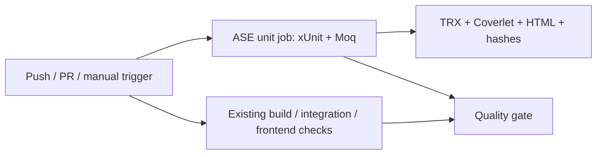

# SE3112 testing pipeline: Group 27

**Project:** FleetFlow Automations
**Individual contribution in this branch:** Sanjeevsaran J., IT24104155, Unit Testing and Mocking.

FleetFlow has four APIs: Identity owns accounts and security; Fleet owns vehicles, maintenance and availability; Rental owns bookings and rental lifecycle; Notification owns delivery and inbox processing. The unit layer tests real Identity and Fleet logic while replacing outbound collaborators. It does not start those APIs or query their databases.

## Ownership and integration

| Member | Assigned area | Integration boundary |
| --- | --- | --- |
| Sanjeevsaran J., IT24104155 | xUnit and Moq unit testing | `Category=ASE.Unit`, runner and unit evidence in this branch |
| Jadavan M., IT24103433 | Stryker.NET mutation testing and pipeline coordination | Reuse the production targets and assertions documented in [unit.md](unit.md); mutation execution is a separate contribution |
| Aqqil M.R.M, IT24104314 | k6 load and performance testing | Separate controlled workload and performance evidence |
| Varun K., IT24103696 | Playwright UI/E2E testing | Separate browser workflows and cross-service evidence |

This branch implements Sanjeevsaran's area. It does not claim that the other three contributions have been implemented or executed here. Coverage supports interpretation of unit tests; it is not an additional individual assignment.

## Start here

1. [Unit implementation, commands and limitations](unit.md).
2. [Two-minute live demo and ten VIVA questions](unit-demo.md).
3. [Committed execution evidence](evidence/unit/README.md), added after execution against the source commit.

From the repository root, with .NET 10, PowerShell and Python 3 installed:

```powershell
./tools/testing/Run-Unit.ps1 -PythonExecutable python -ResultsDirectory artifacts/ase-unit-demo
```

Choose a fresh results directory for each execution. The runner deliberately refuses to replace previous evidence. See the Docker command in `unit.md` if Windows Application Control blocks coverage instrumentation.

## Unified automation

The existing `.github/workflows/ci.yml` contains an independent **ASE : Unit Tests & Coverage** job. Pushes to `test/**`, existing development branches, PRs into `develop`/`main`, and manual dispatch can trigger CI. The unit job has no PostgreSQL or Kafka service dependency. It runs the evidence-tool self-tests, the two filtered xUnit projects, and uploads `ase-unit-evidence` even on failure. The final quality gate depends on this job as well as the existing backend/frontend jobs.



The configuration is supplied in this branch. A local execution is not evidence of a completed GitHub Actions run. After the branch is pushed, retain the successful run URL and downloadable unit artifact with the group submission. No deployment workflow or Azure setting is changed by this contribution.

The team can attach the other three test layers to this same workflow as their owners complete them. Keep each layer's environment, exit status and evidence distinct. Do not make mutation, load or browser results depend on an invented passing placeholder.
